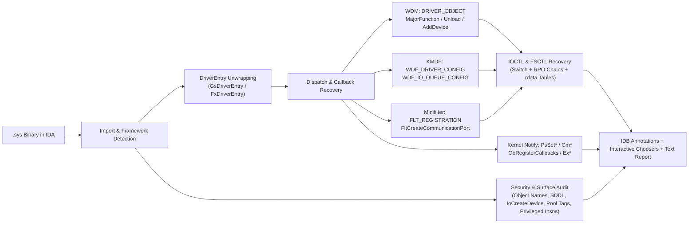

<div align="center">


<br />

[](https://hex-rays.com/)
[](https://www.python.org/)
[](#-features)
[](#-features)
[](LICENSE)

**An automated Windows Kernel Driver (`.sys`) analysis, annotation, and vulnerability triage plugin for IDA Pro 9.x.**  
*Zero external dependencies • Pure modern `ida_*` SDK • GUI & Headless (`idat.exe`) ready*

[✨ Features](#-features) •
[🚀 Installation](#-installation) •
[🎮 Usage & Shortcuts](#-usage--shortcuts) •
[🤖 Headless CLI](#-headless--batch-mode) •
[📊 Sample Report](#-sample-output-report)

</div>

---

## 🎯 Overview

Reverse engineering a Windows kernel driver (`.sys`) starts with the same repetitive manual chores: unwrapping `/GS` or KMDF entry stubs (`GsDriverEntry` / `FxDriverEntry`), tracking down `DriverObject->MajorFunction` or `WDF_IO_QUEUE_CONFIG` assignments, reconstructing compiler-lowered `IOCTL` switch/subtract trees, hunting for registered kernel callbacks (`PsSet*`, `ObRegisterCallbacks`, `FltRegisterFilter`), and checking `IoCreateDevice*` flags and SDDL strings.

**IDASys** automates this entire workflow in **under a second** while strictly preserving existing user/PDB names and types.

<div align="center">

</div>

---

## ✨ Features

| Category | Capability | Details |
| :--- | :--- | :--- |
| 🧬 **Driver & Framework Detection** | Automatic subsystem identification | Detects whether the PE is a kernel-mode image and identifies **WDM**, **KMDF** (`wdfldr.sys`), **Minifilter** (`fltmgr.sys`), **NDIS**, **WFP Callout**, **Storport / SCSI**, **KS / PortCls**, **HID**, and **Video Miniport** frameworks. |
| 🚪 **True `DriverEntry` Discovery** | Unwraps compiler & WDK entry stubs | Follows `/GS` security cookie wrappers (`GsDriverEntry`) and KMDF initialization chains (`FxDriverEntry` → `FxDriverEntryWorker` via `WdfVersionBind` → real `DriverEntry`). Automatically loads `ntddk` type libraries (`TIL`) and applies `NTSTATUS DriverEntry(PDRIVER_OBJECT, PUNICODE_STRING)`. |
| 🧭 **WDM Dispatch Table Recovery** | Full `DRIVER_OBJECT` taint & data-flow | Tracks `DriverObject` across register copies, stack spills, and helper callees (up to depth 3) to recover `MajorFunction[0..27]`, `DriverUnload`, `DriverStartIo`, and `DriverExtension->AddDevice`. Handles `rep stosd/q`, SSE vector broadcasts (`movups`/`movdqu`), and SIB-indexed fill loops. |
| ⚙️ **KMDF Callback Recovery** | Stack & helper `WDF_*_CONFIG` analysis | Recovers `EvtDriverDeviceAdd`, `EvtDriverUnload`, `EvtIoDefault`, `EvtIoRead`, `EvtIoWrite`, `EvtIoDeviceControl`, and `EvtIoInternalDeviceControl` from inline macros, non-inlined `WDF_*_CONFIG_INIT` wrappers, and SSE `.rdata` loads. |
| 🛡️ **Minifilter (`fltmgr.sys`) Support** | `FLT_REGISTRATION` & Communication Ports | Parses static and runtime-patched `FLT_REGISTRATION` structures (`FilterUnloadCallback`, `InstanceSetupCallback`, `InstanceQueryTeardownCallback`, and `FLT_OPERATION_REGISTRATION` `PreOperation`/`PostOperation` arrays) plus `FltCreateCommunicationPort` (`ConnectNotify`, `DisconnectNotify`, `MessageNotify`). |
| 🔔 **Kernel Callbacks & Notify Routines** | EDR / Anti-Cheat / Rootkit triage | Extracts and names callback targets passed to `PsSetCreateProcessNotifyRoutine*`, `PsSetCreateThreadNotifyRoutine*`, `PsSetLoadImageNotifyRoutine*`, `CmRegisterCallback*`, `ObRegisterCallbacks` (`OB_CALLBACK_REGISTRATION` → `OB_OPERATION_REGISTRATION` Pre/Post), `ExRegisterCallback`, `IoRegisterShutdownNotification*`, and `IoRegister*DriverReinitialization`. |
| 🔑 **Deep IOCTL / FSCTL Extraction** | Multi-strategy `CTL_CODE` harvesting | Extracts IOCTLs from **(1)** IDA switch tables (with hole filtering and Clang `ror`/`rol` stride rescaling), **(2)** RPO basic-block data-flow over `sub`/`add`/`dec`/`inc`/`lea` chains & `cmp`/`jz` branches, and **(3)** `.rdata`/`.data` `(ioctl_code, handler_ptr)` dispatch tables. Decodes `DeviceType`, `Function`, `Method` (`METHOD_NEITHER`, etc.), and `Access`. |
| 🔒 **Device Security & SDDL Audit** | Attack surface inspection | Extracts `\Device\`, `\DosDevices\`, `\??\`, `\Registry\` ASCII/UTF-16 paths (via IDA strings + raw segment scanning), SDDL strings (`D:...`), and `IoCreateDevice` / `IoCreateDeviceSecure` call parameters (`DeviceType`, `DeviceCharacteristics` including `FILE_DEVICE_SECURE_OPEN`, and `Exclusive`). |
| 🏷️ **Pool Tag Decoder** | 4-char ASCII tag extraction | Decodes immediate and wrapper-forwarded pool tags (`'Tag!'`) at `ExAllocatePoolWithTag`, `ExAllocatePool2`, `ExAllocatePool3`, `ExFreePoolWithTag`, `FltAllocatePoolAlignedWithTag`, and `NdisAllocateMemoryWithTagPriority` call sites. |
| 🧰 **Kernel API & Privileged Ops** | Categorized xref & instruction scanner | Groups kernel imports into 10 security-focused categories (User buffer handling, Physical memory / I/O, Process/thread access, Security checks, etc.) and locates privileged CPU instructions (`rdmsr`/`wrmsr`, `mov crN/drN`, `in`/`out`, `lidt`/`lgdt`, `vmcall`, `cli`/`sti`). |

---

## 🏗️ Architecture & Analysis Pipeline



---

## 🚀 Installation

### Option 1: PowerShell One-Liner (Recommended)

Run the following command in PowerShell to copy `idasys_plugin.py` and the `idasys/` package directly into your user IDA Pro plugins directory (`%APPDATA%\Hex-Rays\IDA Pro\plugins`):

```powershell
$dest = Join-Path $env:APPDATA "Hex-Rays\IDA Pro\plugins"
New-Item -ItemType Directory -Path $dest -Force | Out-Null
Copy-Item -Path ".\idasys_plugin.py" -Destination $dest -Force
Copy-Item -Path ".\idasys" -Destination "$dest\idasys" -Recurse -Force
```

### Option 2: Manual Installation

Copy **`idasys_plugin.py`** and the **`idasys/`** directory into either:
- `%APPDATA%\Hex-Rays\IDA Pro\plugins\` *(User plugins folder)*, or
- `C:\Program Files\IDA Professional 9.x\plugins\` *(Global IDA plugins folder)*

```text
%APPDATA%\Hex-Rays\IDA Pro\plugins\
├── idasys_plugin.py
└── idasys\
    ├── __init__.py
    ├── analysis.py
    ├── apis.py
    ├── constants.py
    ├── core.py
    ├── ioctl.py
    ├── logic.py
    └── ui.py
```

When IDA Pro opens an x86/x64 binary, the Output window confirms the plugin is active:
```text
IDASys loaded: Edit > IDASys (Ctrl+Alt+D analyze, Ctrl+Alt+I decode IOCTL)
```

---

## 🎮 Usage & Shortcuts

Open any `.sys` driver in IDA Pro and access IDASys via **`Edit ▸ IDASys`**, keyboard shortcuts, or the right-click context menu in Disassembly / Pseudocode views:

| Menu Action (`Edit ▸ IDASys`) | Shortcut | Description |
| :--- | :---: | :--- |
| **Analyze driver (annotate)** | `Ctrl+Alt+D` | Runs full analysis, loads `ntddk` TIL, renames auto-named handlers (`sub_XXXX`), applies function prototypes, annotates instructions with comments, and opens result tables. |
| **Analyze driver (report only)** | — | Runs full analysis in **strictly read-only mode** without modifying any names, types, or comments in the IDB. |
| **Show dispatch routines** | — | Opens the `IRP_MJ_*` / `DriverUnload` / `AddDevice` / `EvtIo*` chooser table. |
| **Show callbacks / notify routines** | — | Opens the Minifilter & Kernel notify callback chooser (`PsSet*`, `Cm*`, `Ob*`, `Flt*`). |
| **Show IOCTL codes** | — | Opens the decoded `CTL_CODE` table (`DeviceType`, `Function`, `Method`, `Access`, `Compared at`, `Case EA`, `Source`, `Scope`). |
| **Show device / object names & security** | — | Lists `\Device\`, `\DosDevices\`, SDDL strings, and `IoCreateDevice*` call security attributes. |
| **Show pool tags** | — | Lists decoded 4-character ASCII pool tags and their allocation call sites. |
| **Show kernel API usage** | — | Lists categorized kernel API imports and every caller function/address. |
| **Show privileged instructions** | — | Lists `rdmsr`, `wrmsr`, `mov crN/drN`, `in`/`out`, `vmcall`, etc. |
| **Decode IOCTL under cursor** | `Ctrl+Alt+I` | Decodes the immediate constant under the cursor (or prompts for a value) into a `CTL_CODE(...)` macro and optionally adds an inline comment. Also available in the right-click menu. |
| **Export report...** | — | Saves the complete text report to a `.txt` file. |

> [!TIP]
> **Double-click any row** in any IDASys chooser window to jump directly to the handler function, case body, or call site in IDA's Disassembly / Pseudocode view.

---

## 🤖 Headless / Batch Mode

IDASys supports unattended batch triage across large corpora of `.sys` drivers using `idat.exe`:

```powershell
# Run full analysis, annotate IDB, and write report to a file:
idat.exe -A -S"C:\path\to\idasys_plugin.py --headless --out=C:\out\report.txt" driver.sys

# Run in strictly read-only mode (no IDB changes):
idat.exe -A -S"C:\path\to\idasys_plugin.py --headless --readonly --out=C:\out\report.txt" driver.sys
```

---

## 📊 Sample Output Report

```text
========================================================================
IDASys driver report
========================================================================
Kernel driver : yes
Architecture  : x64
Framework(s)  : Minifilter, WDM
Entry point   : 0x140001480 GsDriverEntry
DriverEntry   : 0x1400011E0 DriverEntry
Type library  : ntddk64_win10

-- Dispatch routines --
  DriverUnload            0x1400011A0 DriverUnload
  AddDevice               0x1400011C0 DriverAddDevice
  IRP_MJ_CREATE           0x140001020 Dispatch_CREATE_CLOSE
  IRP_MJ_CLOSE            0x140001020 Dispatch_CREATE_CLOSE
  IRP_MJ_READ             0x140001050 Dispatch_READ
  IRP_MJ_DEVICE_CONTROL   0x140001060 Dispatch_DEVICE_CONTROL
  (all other IRP_MJ_*)    0x140001000 DispatchDefault

-- Callbacks & notify routines (8) --
  FilterUnloadCallback                 FltRegisterFilter            0x140001100 FltFilterUnload  @0x140001312
  FltPreOperation(IRP_MJ_CREATE)       FltRegisterFilter            0x140001010 FltPre_CREATE    @0x140002010
  FltPostOperation(IRP_MJ_CREATE)      FltRegisterFilter            0x140001030 FltPost_CREATE   @0x140002010
  ConnectNotifyCallback                FltCreateCommunicationPort   0x140001130 FltPortConnect   @0x140001348
  MessageNotifyCallback                FltCreateCommunicationPort   0x140001150 FltPortMessage   @0x140001348
  ProcessNotifyEx                      PsSetCreateProcessNotifyRoutineEx 0x140001170 ProcessNotifyEx @0x140001362
  RegistryCallback                     CmRegisterCallbackEx         0x140001180 RegistryCallback @0x140001380
  ObPreOperation(PsProcessType)        ObRegisterCallbacks          0x140001190 ObPreOperation   @0x1400013B0

-- Object manager names --
  0x140002100  \Device\SampleDrv
  0x140002130  \DosDevices\SampleDrv
  0x140002160  \SampleFilterPort

-- Device creation & SDDL --
  0x140001254  IoCreateDeviceSecure        Type=FILE_DEVICE_UNKNOWN (0x22)  Characteristics=FILE_DEVICE_SECURE_OPEN (0x100)  Exclusive=False  SDDL=D:P(A;;GA;;;SY)(A;;GA;;;BA)

-- Pool tags (2) --
  'Mflt' (0x746C664D)  FltAllocatePoolAlignedWithTag  @0x140001118 [FltInstanceSetup]
  'Wrap' (0x70617257)  ExAllocatePoolWithTag          @0x140001420 [DriverEntry]

-- IOCTL / FSCTL codes (5) --
  scope: dispatch=handler/direct callee, callee=deeper, global=db-wide scan (lowest confidence)
  0x00222000  dev=FILE_DEVICE_UNKNOWN      fn=0x800 METHOD_BUFFERED   FILE_ANY_ACCESS      @0x14000108C -> 0x140001098 [chain/dispatch]
  0x00222004  dev=FILE_DEVICE_UNKNOWN      fn=0x801 METHOD_BUFFERED   FILE_ANY_ACCESS      @0x14000109E -> 0x1400010B2 [chain/dispatch]
  0x00222007  dev=FILE_DEVICE_UNKNOWN      fn=0x801 METHOD_NEITHER    FILE_ANY_ACCESS      @0x1400010A8 -> 0x1400010CC [switch/dispatch]
  0x00222400  dev=FILE_DEVICE_UNKNOWN      fn=0x900 METHOD_BUFFERED   FILE_ANY_ACCESS      @0x140002080 -> 0x140001140 [table/dispatch]
  0x0022E008  dev=FILE_DEVICE_UNKNOWN      fn=0x802 METHOD_IN_DIRECT  FILE_READ_DATA | FILE_WRITE_DATA @0x1400010D4 -> 0x1400010E8 [chain/callee]

Done in 0.14s
========================================================================
```

---

## 📂 Repository Structure

```text
idasys/
├── assets/                  # SVG banner and workspace preview graphics
├── idasys/                  # Core plugin package
│   ├── __init__.py
│   ├── analysis.py          # IDA-side static analysis, taint tracking & CFG/table scanners
│   ├── apis.py              # Kernel API categorization & privileged instruction definitions
│   ├── constants.py         # WDK constants (IRP_MJ_*, DRIVER_OBJECT offsets, FILE_DEVICE_*)
│   ├── core.py              # Database annotation, TIL loading, and text report rendering
│   ├── ioctl.py             # Pure-Python CTL_CODE encoder/decoder & plausibility filter
│   ├── logic.py             # Pure-Python structure & table parsers (WDM, KMDF, Minifilter, SDDL)
│   └── ui.py                # IDA Qt choosers, menu actions, hotkeys & popup hooks
├── idasys_plugin.py         # IDA Pro plugin entry point & headless CLI runner
├── LICENSE                  # MIT License
└── README.md
```

---

## ⚠️ Known Limitations

- **Indirect / C++ Virtual Dispatch**: If an IOCTL handler routes control codes through C++ virtual method tables or multi-layer custom dispatch objects without immediate comparisons or contiguous `(code, handler_ptr)` tables (e.g. `condrv.sys`), the static IOCTL list will be empty and a note will be added to the report.
- **Obfuscated / Dynamic Strings**: Device names or SDDL strings constructed dynamically on the stack or decrypted at runtime are not extracted statically.
- **Ambiguous Vendor IOCTLs**: Vendor IOCTLs with bit 31 set, a small high word, and function code `< 0x800` (e.g. `0x80000xxx`) are filtered out in strict mode to avoid false positives from `NTSTATUS` and reparse tag constants.
- **Architecture**: Supports `x86` and `x64` (`PLFM_386`) PE drivers only (ARM64 is not currently supported).

---

## 📄 License

Distributed under the [MIT License](LICENSE).
